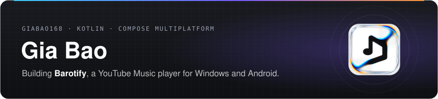

 

<table>
<tr>
<td width="52%"></td>
<td>

### [Barotify](https://github.com/giabao168/Barotify)
**YouTube Music, as a desktop app.**

A player for Windows and Android with a liquid-glass interface, synced word-by-word lyrics, crossfade with a cover hand-over, and a 10-band equalizer. Barotify Lite runs the same app in about 400 MB on older PCs.

Kotlin · Compose Multiplatform · libmpv · Media3 
Fork of <a href="https://github.com/maxrave-dev/SimpMusic">SimpMusic</a>

</td>
</tr>
</table>
